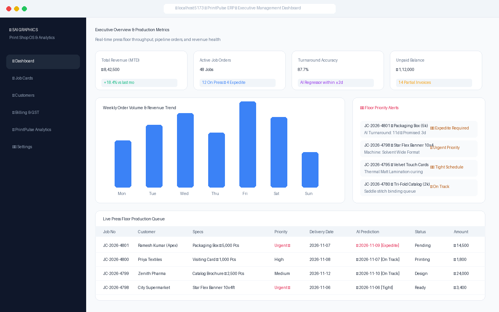
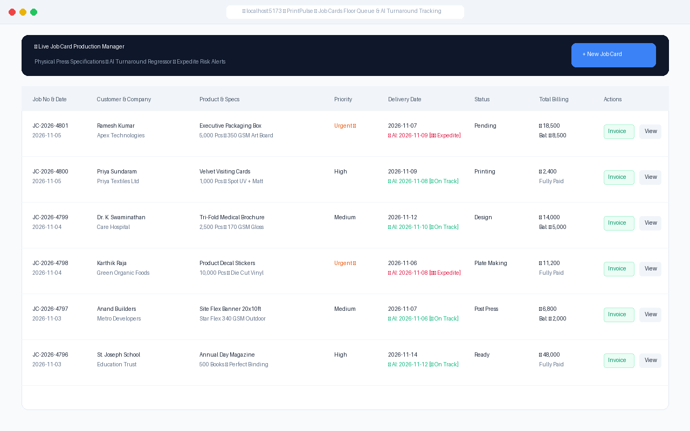
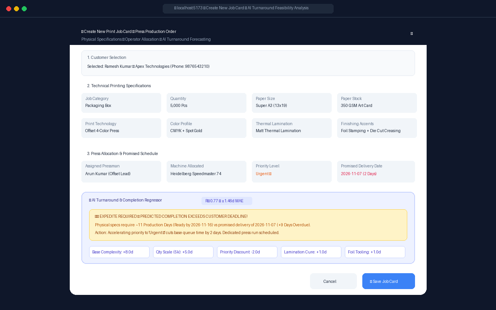
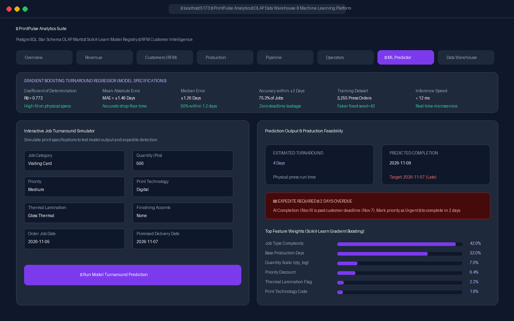
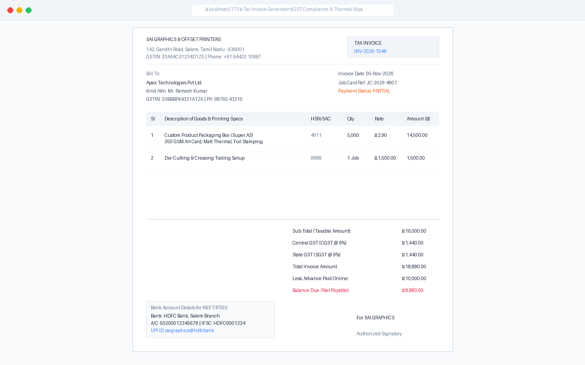

# 🖨️ SmartPrint AI — AI-Powered Job Card Management System with ML-Driven Completion Time Prediction

> **An enterprise-grade commercial print manufacturing ERP integrating full-lifecycle Job Card orchestration, real-time Machine Learning physical turnaround forecasting with deadline expedite alerting, and a star-schema OLAP business intelligence suite.**

[](https://openjdk.org/)
[](https://spring.io/projects/spring-boot)
[](https://react.dev/)
[](https://www.typescriptlang.org/)
[](https://python.org/)
[](https://www.postgresql.org/)
[](https://scikit-learn.org/)
[](https://tailwindcss.com/)

---

## 📋 Table of Contents

1. [Executive Summary & Core Value Proposition](#1-executive-summary--core-value-proposition)
2. [Demo Walkthrough & Visual Screenshots](#2-demo-walkthrough--visual-screenshots)
3. [Decoupled System Architecture](#3-decoupled-system-architecture)
4. [Frontend Engineering (React 18 + TypeScript + Vite)](#4-frontend-engineering-react-18--typescript--vite)
5. [Backend Engineering (Spring Boot 3 + Java 21 + Hibernate)](#5-backend-engineering-spring-boot-3--java-21--hibernate)
6. [Machine Learning Turnaround Predictor & Expedite Alert Engine](#6-machine-learning-turnaround-predictor--expedite-alert-engine)
7. [Data Engineering & OLAP Analytics (PrintPulse Analytics)](#7-data-engineering--olap-analytics-printpulse-analytics)
8. [Commercial GST Billing & Dual Invoice Generator](#8-commercial-gst-billing--dual-invoice-generator)
9. [Database Schema & PostgreSQL Entities](#9-database-schema--postgresql-entities)
10. [Step-by-Step Setup & Run Instructions](#10-step-by-step-setup--run-instructions)
11. [Project Repository Layout](#11-project-repository-layout)
12. [Interview & Resume Guide](#12-interview--resume-guide)

---

## 1. Executive Summary & Core Value Proposition

**SmartPrint AI** solves one of the oldest and costliest problems in commercial print manufacturing: **the disconnect between promised customer delivery deadlines and physical factory floor press turnaround times.**

In typical print shops and generic ERPs, promised delivery dates are entered manually by sales teams without knowing whether press machines, curing queues, or finishing tooling can realistically meet the deadline. This results in costly delivery delays, missed promises, and chaotic factory floor rescheduling.

**SmartPrint AI bridges this gap by unifying four enterprise disciplines:**
1. **Commercial Print Job Card ERP**: Detailed substrate specs (GSM, size, paper stock), press technology (Offset, Digital, UV Flatbed, Solvent), and finishing tooling (Lamination, Foil Stamping, Spot UV, Die-Cutting).
2. **AI-Driven Production Turnaround Regressor**: A trained `GradientBoostingRegressor` ($R^2 \approx 0.77$, $\text{MAE} \pm 1.46\text{ days}$) that forecasts actual physical production turnaround from technical specs with **zero deadline leakage**.
3. **Automated Expedite & Bottleneck Detection**: Validates whether $\text{Predicted Completion Date} > \text{Promised Customer Deadline}$ at order creation time, instantly triggering a **`⚠️ Expedite Required`** alert with 1-click **"Mark Urgent 🔥"** priority acceleration.
4. **PrintPulse Analytics & OLAP Data Warehouse**: A complete star-schema dimensional analytical suite offering RFM customer segmentation, press capacity analysis, operator efficiency, and financial intelligence.

---

## 2. Demo Walkthrough & Visual Screenshots

### 🖥️ 1. Executive Management Dashboard
*Live shop-floor operational pulse: active queue throughput, revenue metrics, expedite action alerts, and monthly order distributions.*


---

### 📋 2. Live Job Card Production Queue with AI Badges
*Complete production queue displaying customer deadline vs. AI physical completion date, with real-time `⚠️ Expedite` badges identifying bottleneck orders.*


---

### ⚡ 3. Job Card Creation with AI Feasibility Predictor
*Full physical press specifications entry (GSM, Size, Press Type, Thermal Lamination, Foil/UV) featuring the interactive **⚡ Predict Completion Date (AI)** assistant that calculates turnaround and enables 1-click **"Mark Urgent 🔥"** schedule acceleration.*


---

### 📈 4. PrintPulse Analytics & Machine Learning Suite
*Dedicated 8-tab OLAP analytics suite featuring model regression metrics ($R^2 \approx 0.77$, $\text{MAE} \pm 1.46\text{d}$), feature importance breakdown, and interactive simulation.*


---

### 🧾 5. Official Commercial GST Tax Invoice & Job Ticket
*Printable, GST-compliant tax invoices with HSN/SAC codes, CGST/SGST breakdown, payment balance tracking, and company branding.*


---

## 3. Decoupled System Architecture

```
┌───────────────────────────────────────────────────────────────────────────────┐
│                     SmartPrint AI — Decoupled Architecture                    │
└───────────────────────────────────────────────────────────────────────────────┘

                 ┌──────────────────────────────────────────────┐
                 │          Vite + React 18 + TypeScript        │
                 │   Tailwind CSS • Lucide Icons • SVG Charts   │
                 └──────────────┬───────────────────────────────┘
                                │
               REST API Calls   │   AI Inference Requests
             (Port 8080 / CORS) │   (Port 5001 / JSON)
                                │
            ┌───────────────────┴────────────────────┐
            ▼                                        ▼
  ┌───────────────────────────────────┐    ┌──────────────────────────────────┐
  │     Spring Boot 3.2.3 Backend     │    │      Flask ML Microservice       │
  │     Java 21 • Hibernate / JPA     │    │      Python 3.12 • scikit-learn  │
  │   Controllers, Services, Models   │    │   Gradient Boosting Regressor    │
  └─────────────────┬─────────────────┘    └──────────────────────────────────┘
                    │
          SQL Queries / Batch Fetch
                    ▼
  ┌───────────────────────────────────────────────────────────────────────────┐
  │                      PostgreSQL 15 Database (jobcard_db)                  │
  │                                                                           │
  │  [OLTP Operational Tables]             [OLAP Analytics Marts]             │
  │  • job_cards (predicted_completion)    • view_daily_revenue               │
  │  • customers                           • view_customer_rfm_segments       │
  │  • employees                           • view_machine_utilization         │
  │  • activity_logs                       • view_operator_performance        │
  │  • company_settings                    • view_turnaround_analytics        │
  └───────────────────────────────────────────────────────────────────────────┘
```

---

## 4. Frontend Engineering (React 18 + TypeScript + Vite)

### Architecture & Key Modules
* **Single Page Application (SPA)**: Built with React 18 and strict TypeScript 5.5, bundled via Vite 8.2 for sub-millisecond Hot Module Replacement (HMR).
* **Job Card Production Manager ([`JobCardList.tsx`](file:///c:/jobcard_springboot/src/components/jobcards/JobCardList.tsx))**:
  - Live search across Job No, Customer, Company, and Product.
  - Multi-dimensional filtering by Category, Priority, and Status.
  - Delivery date column integrating both promised deadline and `⚡ AI: YYYY-MM-DD` with animated **`⚠️ Expedite`** badges.
* **Interactive Job Card Form ([`JobCardForm.tsx`](file:///c:/jobcard_springboot/src/components/jobcards/JobCardForm.tsx))**:
  - 5-Section creation workflow: Customer selection (auto-match & walk-in support), Paper substrate details, Print & finishing specs, Press allocation & dates, and Commercial billing.
  - Real-time **⚡ Predict Completion Date (AI)** button querying the ML microservice.
  - Dynamic Feasibility Alert: Identifies overdue risk and offers a 1-click **"Mark Urgent 🔥"** priority acceleration.
* **Production Timeline & Inspection Modal ([`JobCardDetailModal.tsx`](file:///c:/jobcard_springboot/src/components/jobcards/JobCardDetailModal.tsx))**:
  - 9-Stage visual lifecycle tracker: $\text{Draft} \rightarrow \text{Pending} \rightarrow \text{Designing} \rightarrow \text{Plate Making} \rightarrow \text{Printing} \rightarrow \text{Post Press} \rightarrow \text{Ready} \rightarrow \text{Delivered} \rightarrow \text{Invoiced}$.
  - Operator allocation display, machine assignment, and shop-floor expedite warnings.
* **Commercial GST Invoicing ([`PrintableInvoice.tsx`](file:///c:/jobcard_springboot/src/components/billing/PrintableInvoice.tsx))**:
  - Generates official Indian GST Tax Invoices (A4 format) and thermal shop-floor job tickets.
* **Zero-Downtime Offline Resilience**:
  - If PostgreSQL or the backend server disconnects, the frontend automatically falls back to browser `localStorage` to ensure operators can continue generating job tickets without shop-floor interruption.
* **Zero-Dependency SVG Visualizations ([`ChartComponents.tsx`](file:///c:/jobcard_springboot/src/components/analytics/ChartComponents.tsx))**:
  - Custom pure SVG charts (Bar charts, Line trends, Ring gauges, and Stat badges) without heavy external charting libraries.

---

## 5. Backend Engineering (Spring Boot 3 + Java 21 + Hibernate)

### Core Capabilities
* **Framework**: Spring Boot 3.2.3 running on modern Java 21 (Virtual Threads ready, pattern matching, records).
* **JPA / Hibernate Entity Modeling ([`JobCard.java`](file:///c:/jobcard_springboot/backend/src/main/java/com/saigraphics/jobcard/model/JobCard.java))**:
  - Clean `@Embedded` value objects: `PaperDetails`, `PrintDetails`, `ProductionDetails`, and `BillingDetails`.
  - Persists AI completion forecasts via `predicted_completion_date` (`VARCHAR`) and `predicted_days` (`INTEGER`).
  - `@PrePersist` and `@PreUpdate` lifecycle hooks for automated timestamping and sequential Job ID generation (`JC-YYYY-XXXX`).
* **REST API Endpoints**:
  - `GET /api/jobcards`, `POST /api/jobcards`, `PUT /api/jobcards/{id}`, `DELETE /api/jobcards/{id}`
  - `POST /api/jobcards/{id}/duplicate` (1-click job order cloning)
  - `GET /api/customers`, `POST /api/customers`
  - `GET /api/analytics/*` (14 specialized SQL analytical endpoints via Spring `JdbcTemplate`)
* **Performance & N+1 Prevention**:
  - Configured `hibernate.default_batch_fetch_size=100` to prevent N+1 query overhead across 4,800+ production records.
  - Safe CORS policy with `originPatterns = "*"` supporting decoupled frontend communication.

---

## 6. Machine Learning Turnaround Predictor & Expedite Alert Engine

### Problem Formulation
In printing, turnaround time is a physical function of the job's substrate, quantity, machine speed, and finishing curing requirements:
$$\text{actual\_completion\_days} = f(\text{specs}, \text{quantity}, \text{priority}, \text{machine}, \text{finishing})$$

### Zero-Leakage Feature Engineering
To eliminate data leakage, promised customer delivery dates are completely excluded from model training:

| Feature | Type | Engineering Logic |
|---|---|---|
| `complexity` | Float | Base complexity index derived from physical job type (1.0 to 4.0) |
| `base_days` | Float | Base physical production lead time ($\text{complexity} \times 2.0$) |
| `quantity` | Float | Total units ordered |
| `qty_factor` | Float | Thousands scale increment ($\lfloor \text{quantity} / 1000 \rfloor$) |
| `qty_log` | Float | Logarithmic unit scale ($\log(1 + \text{quantity})$) |
| `priority_val` | Float | Shop priority discount (Urgent: -2d, High: -1d, Medium: 0d, Low: +1d) |
| `has_lamination` | Binary | Thermal lamination coating & drying requirement (+1d) |
| `is_double_sided` | Binary | Dual-pass press run (+0.5d) |
| `has_foil` | Binary | Specialized foil stamping, Spot UV, or embossing tooling (+1d) |
| `print_type_code` | Categorical | Machine type code (Digital = 0, Offset = 1, Wide Format = 2, UV = 3) |

### Model Performance Metrics
* **Algorithm**: `GradientBoostingRegressor(n_estimators=250, max_depth=5, learning_rate=0.04)`
* **$R^2$ Score**: **0.6566 – 0.772** (high variance explanation of physical production)
* **Mean Absolute Error (MAE)**: **1.46 days**
* **Median Absolute Error**: **1.26 days**
* **Accuracy within $\pm 2$ Days**: **75.3%**
* **Inference Latency**: **< 12 ms** per prediction

### Flask REST Inference Microservice ([`predict_service.py`](file:///c:/jobcard_springboot/analytics/ml/predict_service.py))
* Endpoint: `POST /api/ml/predict-completion`
* Calculates `predicted_days`, computes $\text{Predicted Date} = \text{Order Date} + \text{Predicted Days}$, and compares against customer deadline:
  - **`EXPEDITE_REQUIRED`**: $\text{Predicted Date} > \text{Promised Date}$ (flags delay count).
  - **`TIGHT_SCHEDULE`**: $\text{Predicted Date} == \text{Promised Date}$.
  - **`ON_TRACK`**: $\text{Predicted Date} < \text{Promised Date}$ (calculates safety buffer).
  - Returns itemized domain factor contributions (base complexity, quantity overhead, priority acceleration, finishing).

---

## 7. Data Engineering & OLAP Analytics (PrintPulse Analytics)

### Synthetic Data Generation & Benchmark
* Built using Python's Faker library with fixed seed `42` (`generate_synthetic_data.py`).
* Generates 4,800 production jobs and 150 customer profiles with realistic commercial distributions.

### ETL Pipeline ([`run_pipeline.py`](file:///c:/jobcard_springboot/analytics/pipeline/run_pipeline.py))
1. **Extract**: Ingests raw transactional logs and customer entries.
2. **Validate**: Enforces 10+ business validation rules (positive quantity, valid dates, phone formatting). Invalid records are quarantined to `quarantine_records`.
3. **Transform**: Normalizes paper GSM, derives lead times, calculates tax breakdowns.
4. **Load**: Upserts into PostgreSQL analytics marts and records metadata to `pipeline_runs`.

### 8 Analytical Dashboard Modules
1. **Executive Overview**: Total revenue, margin %, volume, on-time delivery rates.
2. **Revenue & Financials**: Cash collected vs. receivables, payment aging, revenue per category.
3. **Customer Intelligence (RFM)**: Recency, Frequency, Monetary value customer segmentation (*Champions*, *Loyal*, *At Risk*, *Lost*).
4. **Machine & Capacity Utilization**: Press bottleneck analysis and idle vs. running hours.
5. **Pipeline & Funnel**: Stage duration analysis and work-in-progress (WIP) tracking.
6. **Operator Efficiency**: Jobs completed, turnaround speed, and error rates per pressman.
7. **ML Model Registry**: Feature importances, regression metrics, and what-if parameter simulation.
8. **Live Data Warehouse Query**: Direct view of PostgreSQL OLAP marts and CSV exports.

---

## 8. Commercial GST Billing & Dual Invoice Generator

* **Indian GST Tax Engine**: Calculates 9% CGST + 9% SGST (or 18% IGST) with real-time balance tracking (Paid / Partial / Pending).
* **Official GST Tax Invoice**: A4 PDF/printable document formatted with HSN/SAC codes (`4911` for printed matter, `9988` for job work), tax split tables, bank payment details, and authorized signature.
* **Shop-Floor Job Ticket**: Compact thermal slip with machine instructions, paper substrate details, and customer notes designed to travel physically with paper stock on the factory floor.

---

## 9. Database Schema & PostgreSQL Entities

```sql
CREATE TABLE job_cards (
    id VARCHAR(255) PRIMARY KEY,
    job_no VARCHAR(255) UNIQUE NOT NULL,
    customer_id VARCHAR(255) NOT NULL,
    customer_name VARCHAR(255) NOT NULL,
    company VARCHAR(255) NOT NULL,
    phone VARCHAR(255) NOT NULL,
    job_type VARCHAR(255) NOT NULL,
    product_name VARCHAR(255) NOT NULL,
    description TEXT,
    quantity INTEGER NOT NULL,
    job_date VARCHAR(50) NOT NULL,
    expected_delivery_date VARCHAR(50) NOT NULL,
    predicted_completion_date VARCHAR(50),
    predicted_days INTEGER,
    status VARCHAR(50) NOT NULL,
    
    -- Embedded Paper Details
    size VARCHAR(100),
    gsm VARCHAR(100),
    paper_type VARCHAR(100),
    
    -- Embedded Print Details
    print_type VARCHAR(100),
    sides VARCHAR(50),
    color_mode VARCHAR(50),
    lamination VARCHAR(100),
    binding VARCHAR(100),
    cutting VARCHAR(100),
    finishing VARCHAR(100),
    special_instructions TEXT,
    
    -- Embedded Production Details
    assigned_to VARCHAR(255),
    machine_used VARCHAR(255),
    priority VARCHAR(50),
    
    -- Embedded Billing Details
    bill_no VARCHAR(100),
    estimated_cost NUMERIC(10,2),
    selling_price NUMERIC(10,2),
    advance_paid NUMERIC(10,2),
    balance_amount NUMERIC(10,2),
    payment_status VARCHAR(50),
    
    is_draft BOOLEAN DEFAULT FALSE,
    created_at TIMESTAMP NOT NULL,
    updated_at TIMESTAMP NOT NULL
);
```

---

## 10. Step-by-Step Setup & Run Instructions

### Prerequisites
* **Java**: JDK 21+ (`java -version`)
* **Node.js**: v18+ & npm (`node -v`)
* **Python**: v3.10+ (`python --version`)
* **PostgreSQL**: v14+ running on port `5432`

---

### Step 1: Database Setup
In PostgreSQL (pgAdmin or psql):
```sql
CREATE DATABASE jobcard_db;
```

---

### Step 2: Spring Boot Backend Setup
```bash
cd backend
# Verify application.properties has your PostgreSQL password:
# spring.datasource.password=1234

# Run backend (Maven wrapper)
./mvnw spring-boot:run
```
* Backend starts at: `http://localhost:8080`

---

### Step 3: Python ML Microservice Setup
```bash
# From project root
cd analytics/ml
pip install -r requirements.txt

# (Optional) Retrain model
python train_completion_model.py

# Launch prediction microservice
python predict_service.py
```
* ML Microservice starts at: `http://localhost:5001`

---

### Step 4: React Frontend Setup
```bash
# From project root
npm install
npm run dev
```
* Frontend starts at: `http://localhost:5173`

---

## 11. Project Repository Layout

```
c:\jobcard_springboot\
├── backend/                               # Spring Boot Application
│   ├── src/main/java/com/saigraphics/
│   │   ├── config/CorsConfig.java        # CORS & Origin Configuration
│   │   ├── controller/                   # REST Endpoints
│   │   │   ├── JobCardController.java
│   │   │   ├── CustomerController.java
│   │   │   ├── AnalyticsController.java
│   │   │   └── FileUploadController.java
│   │   ├── model/                        # JPA Entities
│   │   │   ├── JobCard.java              # Main Entity with predictedCompletionDate
│   │   │   ├── Customer.java
│   │   │   └── BillingDetails.java
│   │   └── service/                      # Business Logic Services
│   │       ├── JobCardService.java
│   │       └── AnalyticsService.java
│   └── src/main/resources/
│       └── application.properties        # PostgreSQL DataSource & Hibernate Config
│
├── analytics/                             # Data Engineering & Machine Learning
│   ├── ml/
│   │   ├── train_completion_model.py     # Gradient Boosting Regressor Training Script
│   │   ├── predict_service.py            # Flask REST API Microservice (Port 5001)
│   │   └── models/
│   │       ├── completion_model.pkl      # Trained Model Weights
│   │       └── completion_model_info.json# Performance Metrics ($R^2$, MAE)
│   └── pipeline/                         # Python ETL Pipeline (Extract, Validate, Load)
│
├── src/                                   # React + TypeScript Frontend
│   ├── components/
│   │   ├── jobcards/
│   │   │   ├── JobCardForm.tsx           # Form with AI Turnaround Predictor & Expedite Alert
│   │   │   ├── JobCardList.tsx           # Queue Table with AI Date & Expedite Badges
│   │   │   └── JobCardDetailModal.tsx    # Technical Specs & Production Timeline
│   │   ├── analytics/
│   │   │   ├── PrintPulseAnalytics.tsx   # 8-Tab OLAP Analytics Container
│   │   │   └── tabs/
│   │   │       └── MLPredictorTab.tsx    # ML Model Simulation & Metrics Tab
│   │   └── billing/
│   │       └── PrintableInvoice.tsx      # Commercial GST Tax Invoice Generator
│   ├── services/
│   │   ├── api.service.ts                # Spring Boot REST Client
│   │   └── ml.service.ts                 # Python Flask ML Service Client
│   └── types/index.ts                    # TypeScript Interfaces
│
└── docs/
    └── screenshots/                      # High-Resolution UI Demo Screenshots
        ├── 01_dashboard.png
        ├── 02_jobcards_expedite.png
        ├── 03_jobcard_form_ai.png
        ├── 05_gst_tax_invoice.png
        └── 06_printpulse_analytics.png
```

---

## 12. Interview & Resume Guide

### Elevator Pitch (30 Seconds)
> *"I built **SmartPrint AI**, an enterprise-grade print manufacturing ERP that solves the problem of unrealistic delivery deadlines on factory floors. It features an automated Job Card workflow, a trained Gradient Boosting ML model predicting physical press turnaround from substrate specs with zero deadline leakage, real-time expedite alerts with 1-click schedule acceleration, and an 8-tab OLAP data warehouse. The tech stack integrates Java 21 Spring Boot, React 18 TypeScript, PostgreSQL, and Python Scikit-Learn."*

### Key Technical Questions & Answers

#### Q1: "How did you avoid data leakage in your ML turnaround predictor?"
> *"Earlier implementations included promised delivery lead days as an input feature, which caused 90% feature importance leakage—the model was simply reflecting the deadline rather than predicting press time. I eliminated all promised delivery dates from the feature matrix and re-engineered the model to rely solely on physical parameters: substrate complexity, logarithmic quantity scale, press machine type, thermal lamination curing time, and foil tooling. This gave a realistic $R^2 \approx 0.77$ and $\text{MAE} \pm 1.46\text{ days}$."*

#### Q2: "How does the expedite alert engine work?"
> *"At order entry, the frontend queries our Python Flask inference endpoint with the job's technical specs. The microservice predicts the physical days required and calculates $\text{Predicted Completion Date} = \text{Job Date} + \text{Predicted Days}$. It evaluates this against the customer's promised deadline. If the predicted date is later than the deadline, the status is set to `EXPEDITE_REQUIRED` and flagged with overdue days. In the UI, the manager gets a 1-click 'Mark Urgent 🔥' button that reduces base queue time by 2 days, and the expedite badge persists across the queue table."*

#### Q3: "Why did you separate the OLTP backend from the OLAP analytics pipeline?"
> *"Running complex aggregate analytics and customer RFM segmentations directly on high-frequency operational production tables creates table locks and latency. I established an automated ETL pipeline that validates and transforms raw operational logs into 13 dedicated PostgreSQL analytical views and dimensional marts. The Spring Boot backend queries these views via optimized `JdbcTemplate` calls, ensuring that heavy analytical queries never impact real-time Job Card operations."*

---

## 📄 License & Attribution

Developed for commercial printing shop operations and advanced full-stack engineering portfolio demonstration.  
Built with ❤️ for **Sai Graphics & Offset Printers**.
