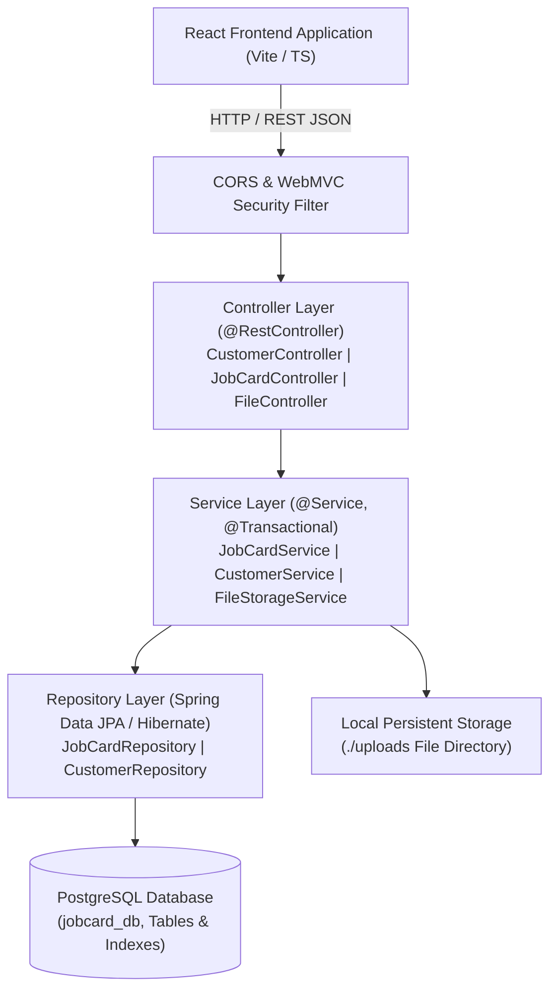

# 🚀 PRINT JOB CARD MANAGEMENT SYSTEM — SPRING BOOT & POSTGRESQL BACKEND ARCHITECTURE & INTERVIEW PREPARATION GUIDE

---

## 📌 Executive Summary & Interview Pitch

> *"In this project, I was responsible for designing and developing the complete backend system using **Java 17, Spring Boot 3.2, and PostgreSQL**. I refactored the application architecture from a client-heavy direct database access pattern into a decoupled, layered REST API architecture. I designed the relational database schema, implemented custom JPA repositories with Hibernate ORM, structured transactional service boundaries, and built secure, RESTful controllers. I also engineered the file management system with multipart streaming and implemented real-time activity audit logging."*

---

## 🏗️ 1. High-Level Backend System Architecture

The backend follows the industry-standard **Layered / Tiered Architecture** ensuring Separation of Concerns (SoC), maintainability, and testability.



---

## 🗄️ 2. PostgreSQL Relational Database Schema Design

### Key Tables & Relationships
1. **`customers`**: Stores client profile, company details, GSTIN, and contact information.
2. **`job_cards`**: Central entity capturing print job lifecycle, product specifications, embedded paper/print/production/billing details.
3. **`job_card_timeline`**: Audit trail capturing every status change (e.g. `Pending` ➔ `Designing` ➔ `Printing` ➔ `Ready` ➔ `Delivered`).
4. **`job_card_files`**: File metadata referencing uploaded print proofs, vector artworks, and invoices.
5. **`employees`**: Staff and press operator directory for job assignment.
6. **`company_settings`**: Global configuration (job numbering prefix `JC-2026-`, terms & conditions, tax details).
7. **`activity_logs`**: System audit logs capturing operations executed across the application.

```sql
-- Sample DDL Snapshot
CREATE TABLE job_cards (
    id VARCHAR(100) PRIMARY KEY,
    job_no VARCHAR(50) UNIQUE NOT NULL,
    customer_id VARCHAR(100) NOT NULL,
    customer_name VARCHAR(255) NOT NULL,
    job_type VARCHAR(100) NOT NULL,
    product_name VARCHAR(255) NOT NULL,
    quantity INTEGER NOT NULL DEFAULT 1,
    
    -- Embedded Objects
    paper_size VARCHAR(100), paper_gsm VARCHAR(50), paper_type VARCHAR(100),
    print_type VARCHAR(100), print_sides VARCHAR(50), print_color_mode VARCHAR(100),
    assigned_to VARCHAR(255), priority VARCHAR(50),
    
    status VARCHAR(50) DEFAULT 'Pending' NOT NULL,
    selling_price NUMERIC(12, 2), advance_paid NUMERIC(12, 2), balance_amount NUMERIC(12, 2),
    created_at TIMESTAMP WITH TIME ZONE DEFAULT CURRENT_TIMESTAMP NOT NULL
);
```

---

## 🛠️ 3. Core Spring Boot Technical Highlights & Code Walkthrough

### 3.1 Domain Model Design (JPA `@Embedded` & `@OneToMany`)
To represent composite values like `PaperDetails`, `PrintDetails`, `ProductionDetails`, and `BillingDetails` cleanly without cluttering foreign key relations, I used Spring Data JPA's `@Embeddable` and `@Embedded` annotations.

```java
@Entity
@Table(name = "job_cards")
@Data
@Builder
public class JobCard {
    @Id
    private String id;

    @Column(name = "job_no", unique = true, nullable = false)
    private String jobNo;

    @Embedded
    private PaperDetails paperDetails;

    @Embedded
    private PrintDetails printDetails;

    @Embedded
    private BillingDetails billing;

    @OneToMany(cascade = CascadeType.ALL, orphanRemoval = true, fetch = FetchType.EAGER)
    @JoinColumn(name = "job_card_id")
    private List<TimelineEvent> timeline;
}
```

### 3.2 Service Layer Transactionality & Business Logic
In `JobCardService`, I enforced atomic database updates using `@Transactional`. For example, when updating a job's status or recording a payment, the timeline event creation, balance recalculation, and activity log entry are committed within a single database transaction.

```java
@Transactional
public JobCard updateStatus(String id, String status, String note) {
    JobCard jobCard = getJobCardById(id);
    jobCard.setStatus(status);
    
    TimelineEvent event = TimelineEvent.builder()
            .id("t-" + System.currentTimeMillis())
            .jobCardId(id)
            .status(status)
            .timestamp(LocalDateTime.now())
            .note(note)
            .updatedBy(settingsService.getSettings().getOwnerName())
            .build();

    jobCard.getTimeline().add(event);
    return jobCardRepository.save(jobCard);
}
```

### 3.3 REST Controller Layer & Error Handling
I implemented RESTful controllers using `@RestController` with proper HTTP status codes (`200 OK`, `201 Created`, `204 No Content`, `404 Not Found`). Global exception handling is governed by `@RestControllerAdvice`.

```java
@RestControllerAdvice
public class GlobalExceptionHandler {
    @ExceptionHandler(ResourceNotFoundException.class)
    public ResponseEntity<Map<String, Object>> handleNotFound(ResourceNotFoundException ex) {
        Map<String, Object> body = new HashMap<>();
        body.put("timestamp", LocalDateTime.now());
        body.put("status", 404);
        body.put("message", ex.getMessage());
        return new ResponseEntity<>(body, HttpStatus.NOT_FOUND);
    }
}
```

---

## 🎯 4. Essential Interview Q&A Script (Be Ready to Answer!)

### Q1: "Why did you choose Spring Boot and PostgreSQL for this project?"
> **Answer:** *"Spring Boot provides an enterprise-ready framework with out-of-the-box support for REST APIs, dependency injection, and data persistence via Spring Data JPA. PostgreSQL was chosen for its strict ACID compliance, strong relational support, indexing capabilities, and performance with numerical billing data and query operations."*

### Q2: "How did you manage database tables and mappings in Java?"
> **Answer:** *"I used Spring Data JPA and Hibernate ORM. Entities like `Customer`, `Employee`, `JobCard`, and `ActivityLog` map directly to PostgreSQL tables. Composite value objects (like `PaperDetails` or `BillingDetails`) were mapped using JPA `@Embedded` to maintain clean domain objects without excessive table joins."*

### Q3: "How did you handle file uploads in Spring Boot?"
> **Answer:** *"I built a dedicated `FileStorageService` using Spring's `MultipartFile` interface. Files are saved to a configurable local disk directory using Java NIO (`java.nio.file.Files`), while file metadata (URL, file size, mime type, timestamp) is stored in the PostgreSQL `job_card_files` table."*

### Q4: "How do you handle concurrency and transactional consistency?"
> **Answer:** *"I used Spring's `@Transactional` annotation on the service layer methods. This ensures that operations modifying multiple tables—such as updating a job status while appending a timeline event and writing an activity log—execute atomically. If any part fails, Hibernate rolls back all changes."*

---

## 📁 5. Backend Directory Structure in Cloned Project

```
c:\jobcard_springboot\backend\
├── pom.xml
└── src\main\
    ├── java\com\saigraphics\jobcard\
    │   ├── JobcardApplication.java
    │   ├── config\CorsConfig.java
    │   ├── controller\
    │   │   ├── CustomerController.java
    │   │   ├── JobCardController.java
    │   │   ├── EmployeeController.java
    │   │   ├── CompanySettingsController.java
    │   │   ├── ActivityLogController.java
    │   │   └── FileUploadController.java
    │   ├── exception\
    │   │   ├── ResourceNotFoundException.java
    │   │   └── GlobalExceptionHandler.java
    │   ├── model\
    │   │   ├── Customer.java
    │   │   ├── Employee.java
    │   │   ├── JobCard.java
    │   │   ├── JobCardFile.java
    │   │   ├── TimelineEvent.java
    │   │   ├── CompanySettings.java
    │   │   ├── ActivityLog.java
    │   │   ├── PaperDetails.java
    │   │   ├── PrintDetails.java
    │   │   ├── ProductionDetails.java
    │   │   └── BillingDetails.java
    │   ├── repository\
    │   │   ├── CustomerRepository.java
    │   │   ├── JobCardRepository.java
    │   │   ├── EmployeeRepository.java
    │   │   ├── CompanySettingsRepository.java
    │   │   ├── ActivityLogRepository.java
    │   │   └── JobCardFileRepository.java
    │   └── service\
    │       ├── CustomerService.java
    │       ├── JobCardService.java
    │       ├── EmployeeService.java
    │       ├── CompanySettingsService.java
    │       ├── ActivityLogService.java
    │       └── FileStorageService.java
    └── resources\
        ├── application.properties
        ├── schema.sql
        └── data.sql
```
